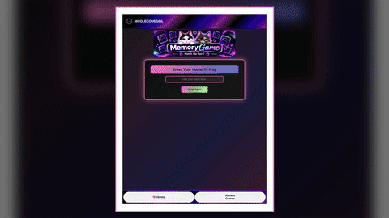

# :purple_heart: Hi, I'm NicoleCodeGirl! :purple_heart:

I build games and tools on the web — check out my Memory Game below.

### My Memory Game

NEW theme: Zodiac Cats — match all 13 zodiac cat medallions!

### Memory Game Preview

### Here are my GitHub Stats

### Find my work

- 🌐 Website: [nicolecodegirl.com](https://nicolecodegirl.com)
- 🛍️ Etsy: [NicoleCodeGirl on Etsy](https://www.etsy.com/shop/NicoleCodeGirl) — digital downloads, crafts & cat-inspired creations
- 💼 LinkedIn (my security career): [linkedin.com/in/nicolecodegirl](https://www.linkedin.com/in/nicolecodegirl)

# 💻 Tech Stack:
                 

